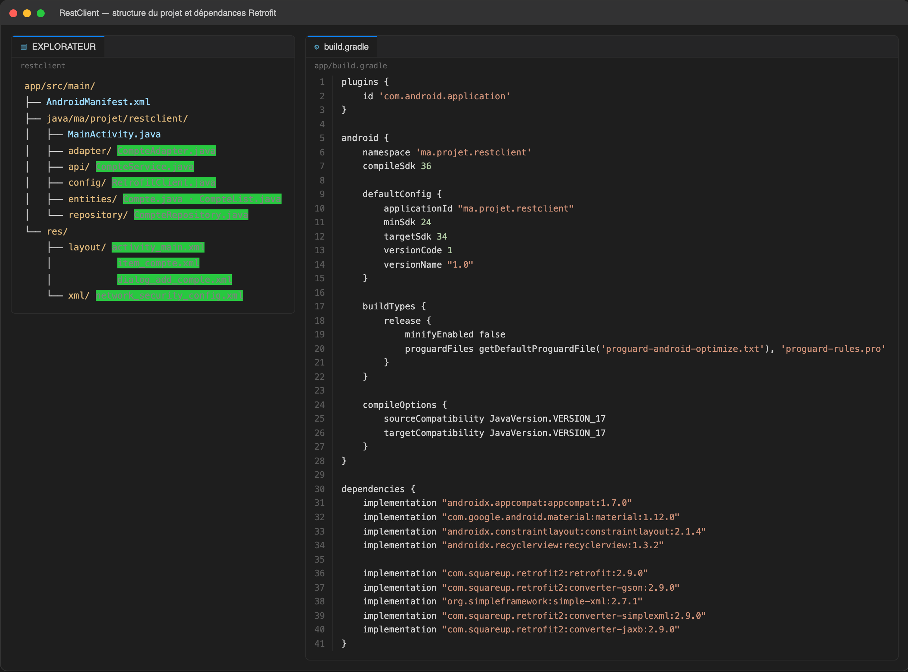
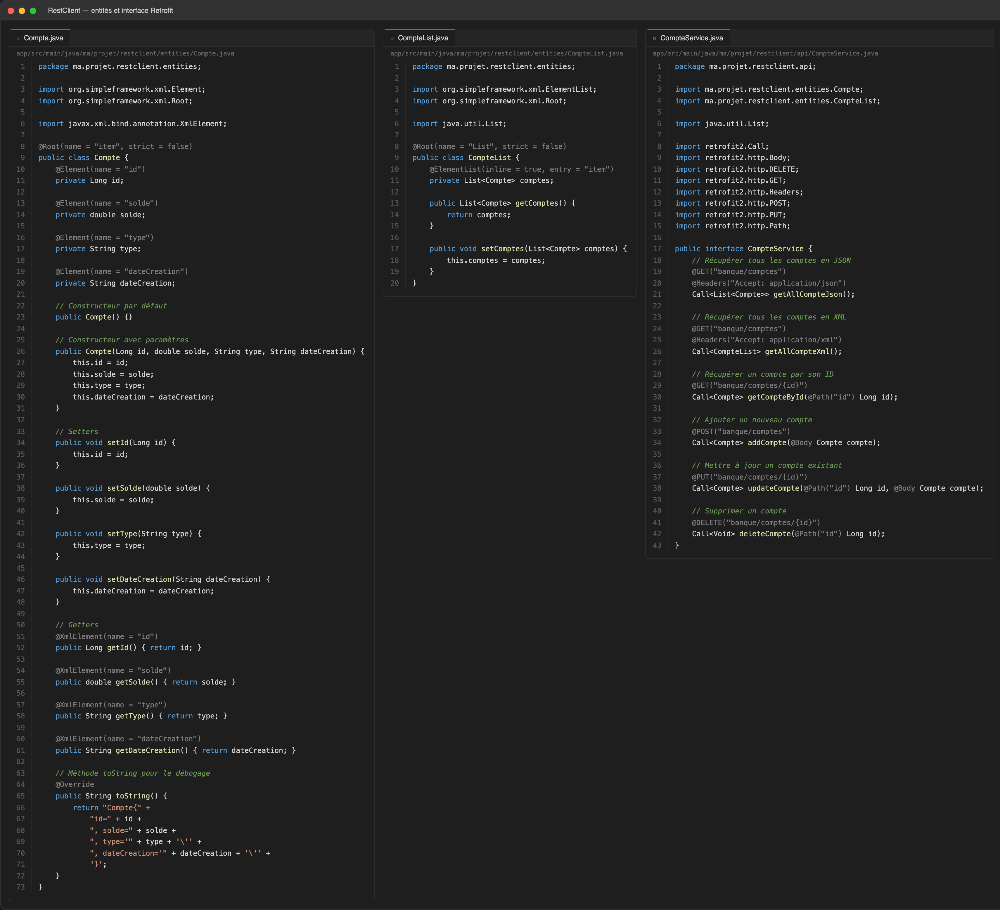
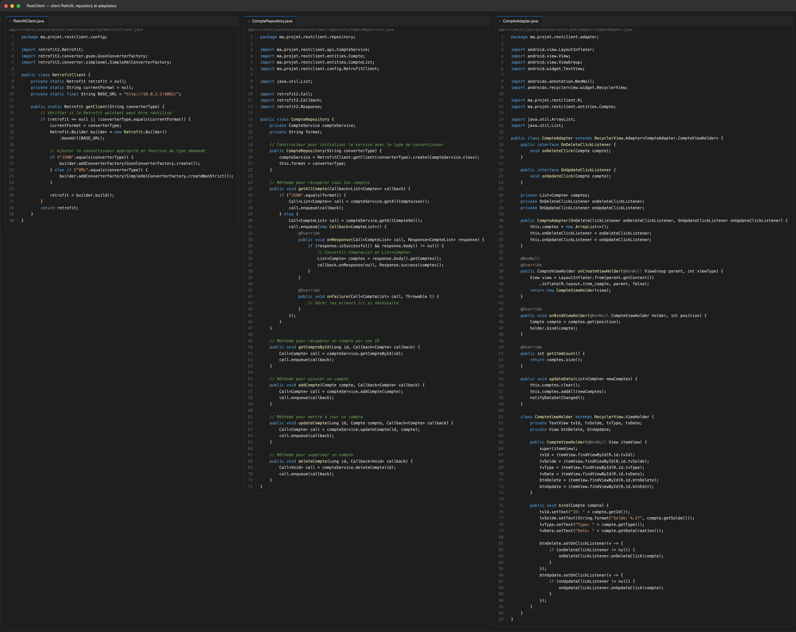
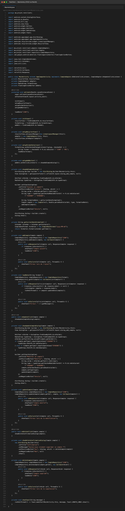
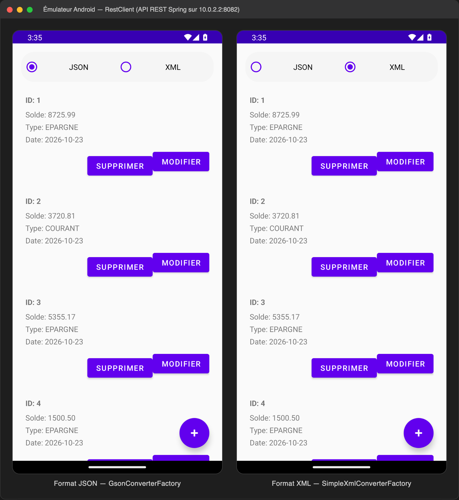

# TP 10 : Client REST Android Retrofit (XML & JSON)

Application Android (`ma.projet.restclient`) qui consomme l'API REST Spring du TP 8
(`GET/POST/PUT/DELETE /banque/comptes`) avec **Retrofit**. Deux boutons radio **JSON** / **XML**
choisissent le convertisseur : `RetrofitClient` construit alors un client Retrofit avec
`GsonConverterFactory` ou `SimpleXmlConverterFactory`, et `CompteRepository` uniformise la réponse
(`List<Compte>` en JSON, `CompteList` -> `List<Compte>` en XML) avant de la remonter à `MainActivity`.
La liste est affichée dans un `RecyclerView` et le CRUD complet (ajout, modification, suppression)
est disponible depuis l'interface, sur le serveur local `http://10.0.2.2:8082/`.

## 1. Structure du projet et dépendances Retrofit

## 2. Entités XML et interface du service REST

## 3. Client Retrofit, repository et adaptateur

## 4. MainActivity : chargement, ajout, modification et suppression

## 5. Exécution : liste des comptes en JSON et en XML

